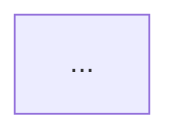

# Markdown Writing

Master Markdown syntax, GitHub Flavored Markdown, Mermaid diagrams, and documentation templates. Covers style guides, diagram types, document templates, and rendering validation.

## Quick Start

**Step 1: Pick your document type**

Load the template for your use case:

| Document | Template file |
|---|---|
| Technical doc / README | `assets/templates/project-documentation.md` |
| Architecture decision | `assets/templates/decision-record.md` |
| Research / analysis | `assets/templates/research-paper.md` |
| Pull request | `assets/templates/pull-request.md` |
| Issue / bug report | `assets/templates/issue.md` |
| Project status | `assets/templates/status-report.md` |
| Presentation / briefing | `assets/templates/presentation.md` |
| How-to / tutorial | `assets/templates/how-to-guide.md` |
| Kanban / sprint board | `assets/templates/kanban.md` |

**Step 2: Apply the style guide**

Read `assets/references/markdown-style-guide.md` (5 min). Key rules:
- One H1 (title) per document
- Headings: emoji não é exigido
- Tables for comparisons; diagrams for relationships
- Bold sparingly (2–3 terms per paragraph max)
- Support claims with sources

**Step 3: Add Mermaid diagrams (optional)**

Before creating any diagram:
1. Scan `assets/references/mermaid-diagram-types.md` (table of 23 types + use cases)
2. Read the guide for your type (e.g., `assets/references/diagrams/flowchart.md`)
3. Use the template and tips in that file
4. Test rendering in your destination (GitHub, GitLab, local)

See `assets/references/mermaid-style-guide.md` for accessibility, emoji rules, and color classes.

**Step 4: Validate before shipping**

See `assets/references/current-rendering.md` for:
- Mermaid 12.0.0 changes and breaking syntax
- CLI export steps
- Accessibility matrix (which diagram types support `accTitle`/`accDescr`)
- Browser rendering checks

---

## Common Tasks

<details>
<summary><strong>How do I write better Markdown?</strong></summary>

Read `assets/references/markdown-style-guide.md`. Focus on:
- One H1 per document
- Use tables for data, diagrams for relationships
- Headings as scannable signposts, not as decoration

See also: `assets/references/markdown-syntax/` for text formatting, lists, links, code blocks, and tables.

</details>

<details>
<summary><strong>How do I choose a diagram type?</strong></summary>

Open `assets/references/mermaid-diagram-types.md`. It maps use cases (workflow, timeline, hierarchy, etc.) to diagram types.

**Common picks:**
- Workflow / decision logic → **Flowchart**
- Chronological events → **Timeline**
- Service interactions → **Sequence**
- Data model / schema → **ER Diagram**
- System architecture → **C4** or **Architecture**
- Concept hierarchy → **Mindmap**

Don't default to flowcharts. Read the guide for your type before coding.

</details>

<details>
<summary><strong>My diagram isn't rendering. What's wrong?</strong></summary>

1. **Check syntax** — Open `assets/references/diagrams/<type>.md` and compare your code to the template.
2. **Check version** — See `assets/references/current-rendering.md` for Mermaid 12.0.0 breaking changes (e.g., `radar-beta` vs `radar`, `xychart-beta` syntax).
3. **Test in destination** — Render locally or in GitHub before shipping. Different hosts support different Mermaid versions.
4. **Add fallback text** — If the host doesn't support your diagram type, place a descriptive paragraph above the code block.

</details>

<details>
<summary><strong>How do I add accessibility to diagrams?</strong></summary>

For diagram types that support it (flowchart, sequence, class, state, ER, C4, architecture, mindmap, timeline, user-journey, quadrant, requirement, sankey, kanban, gantt, git-graph, zenuml):



For types that don't support `accTitle`/`accDescr`, place a descriptive italic paragraph directly above the code block.

See `assets/references/current-rendering.md` for the full accessibility matrix.

</details>

<details>
<summary><strong>How do I export a diagram to PNG/SVG?</strong></summary>

Use Mermaid CLI:

```bash
npm install -g @mermaid-js/mermaid-cli
mmdc -i input.md -o output.png
```

Keep both `.md` (source) and `.png` (export) in version control. Retain `.md` as the single source of truth.

See `assets/references/current-rendering.md` for detailed steps and browser APIs.

</details>

---

## Reference Index

### Style Guides

| Guide | What it covers | Time |
|---|---|---|
| [Markdown Style Guide](assets/references/markdown-style-guide.md) | Headings, formatting, citations, tables, Mermaid integration, templates, quality checklist | 5 min |
| [Mermaid Style Guide](assets/references/mermaid-style-guide.md) | Accessibility, emoji set, color classes, theme neutrality, type selection, complexity tiers | 5 min |
| [Current Rendering & Validation](assets/references/current-rendering.md) | Mermaid 12.0.0 changes, CLI export, browser APIs, accessibility matrix, scientific checks | Reference |

### Markdown Syntax Reference

Each file covers a specific Markdown feature with examples:

- [Text Formatting](assets/references/markdown-syntax/text-formatting.md) — bold, italic, strikethrough, inline code
- [Lists](assets/references/markdown-syntax/lists.md) — ordered, unordered, nested, mixed
- [Links & Images](assets/references/markdown-syntax/links-and-images.md) — inline/reference links, image syntax, alt text
- [Code Blocks](assets/references/markdown-syntax/code-blocks.md) — inline, fenced, language spec, syntax highlighting
- [Tables](assets/references/markdown-syntax/tables.md) — basic, alignment, nesting, accessibility
- [GitHub Flavored Markdown](assets/references/markdown-syntax/gfm-extended.md) — strikethrough, task lists, autolinks, blockquotes
- [Alerts & Callouts](assets/references/markdown-syntax/alerts-and-callouts.md) — blockquote syntax, emphasis blocks
- [Collapsible Sections](assets/references/markdown-syntax/collapsible-sections.md) — `<details>` syntax, nesting

### Mermaid Diagram Types (23 types)

Each guide includes a production exemplar, type-specific tips, and a copy-paste template:

**Workflows & Logic**
- [Flowchart](assets/references/diagrams/flowchart.md) — decision logic, experimental workflows
- [State Diagram](assets/references/diagrams/state.md) — state machines, lifecycles
- [Requirement Diagram](assets/references/diagrams/requirement.md) — requirements traceability

**Relationships & Structure**
- [ER Diagram](assets/references/diagrams/er.md) — data models, schemas
- [Class Diagram](assets/references/diagrams/class.md) — type hierarchies, relationships
- [C4 Diagram](assets/references/diagrams/c4.md) — system architecture (zoom levels)
- [Architecture Diagram](assets/references/diagrams/architecture.md) — cloud infrastructure, service topology

**Sequences & Timing**
- [Sequence Diagram](assets/references/diagrams/sequence.md) — service interactions, API calls, messaging
- [Timeline Diagram](assets/references/diagrams/timeline.md) — chronological events, history
- [Gantt Diagram](assets/references/diagrams/gantt.md) — project timeline, roadmap, scheduling
- [Git Graph](assets/references/diagrams/git_graph.md) — git branching, merge strategy

**Hierarchies & Composition**
- [Mindmap](assets/references/diagrams/mindmap.md) — concept hierarchy, brainstorm
- [Block Diagram](assets/references/diagrams/block.md) — component layout, spatial arrangement
- [Packet Diagram](assets/references/diagrams/packet.md) — binary protocol, data format

**Data & Metrics**
- [Pie Chart](assets/references/diagrams/pie.md) — proportions, composition
- [XY Chart](assets/references/diagrams/xy_chart.md) — numeric trends, bar + line charts
- [Sankey Diagram](assets/references/diagrams/sankey.md) — flow magnitude, resource distribution
- [Radar Chart](assets/references/diagrams/radar.md) — multi-dimensional comparison, skills matrix
- [Treemap](assets/references/diagrams/treemap.md) — hierarchical proportions, budget allocation

**Planning & User Flows**
- [Kanban](assets/references/diagrams/kanban.md) — work item status, task columns
- [User Journey](assets/references/diagrams/user_journey.md) — user flow, satisfaction map
- [Quadrant Chart](assets/references/diagrams/quadrant.md) — two-axis comparison, prioritization

**Advanced**
- [ZenUML](assets/references/diagrams/zenuml.md) — code-style sequence diagrams, programming syntax
- [Complex Examples](assets/references/diagrams/complex-examples.md) — multi-diagram composition patterns

### Document Templates

Start from the template for your document type:

- [Project Documentation](assets/templates/project-documentation.md) — README, technical guide, project overview
- [Architecture Decision Record](assets/templates/decision-record.md) — ADR, design decision
- [Research Paper](assets/templates/research-paper.md) — analysis, findings, conclusions
- [Pull Request](assets/templates/pull-request.md) — PR description, summary of changes
- [Issue](assets/templates/issue.md) — bug report, feature request, enhancement
- [Status Report](assets/templates/status-report.md) — progress update, blockers, metrics
- [Presentation](assets/templates/presentation.md) — briefing, slideshow outline
- [How-To Guide](assets/templates/how-to-guide.md) — tutorial, step-by-step instructions
- [Kanban Board](assets/templates/kanban.md) — sprint board, task tracking

### Examples

- [Research Report Example](assets/examples/example-research-report.md) — synthetic quality-control report with data table, flowchart, bar chart, and chronology. Auditable and reproducible.

---

## Integration with Other Skills

**With `artifact-diagramming`** — for inline SVG diagrams and legibility in light/dark themes.

**With `dataviz`** — for quantitative charts, stat tiles, and dashboards. Use Mermaid for structural diagrams; use `dataviz` for measured data and statistical graphics.

**With `scientific-writing` or `research`** — Mermaid handles workflows, methods overviews, and conceptual relationships. Use plotting libraries for quantitative figures.

---

## Best Practices Checklist

Before finalizing any document:

- [ ] One H1 per document (the title)
- [ ] All external claims supported with sources
- [ ] Tables used for data; diagrams for relationships/workflows
- [ ] Bold used sparingly (2–3 terms per paragraph max)
- [ ] Accessibility metadata (`accTitle`/`accDescr`) on diagrams where supported
- [ ] Diagram rendering tested in destination (GitHub, GitLab, local)
- [ ] Relative links used for internal docs; absolute URLs for external
- [ ] Alt text provided for all images
- [ ] Code blocks have language specification (markdown, bash, python, etc.)
- [ ] No walls of text; semantic line breaks applied
- [ ] Links tested and working

---

## Attribution & License

Mermaid guides, diagram templates, and document templates are ported from the `SuperiorByteWorks-LLC/agent-project` repository under the Apache-2.0 License.

- **Source**: https://github.com/SuperiorByteWorks-LLC/agent-project
- **Author**: Clayton Young / Superior Byte Works, LLC (@borealBytes)
- **License**: Apache-2.0
- **Contributors**: K-Dense Team (integration and community feedback)

Distributed under the Apache-2.0 License. Attribution retained throughout.
