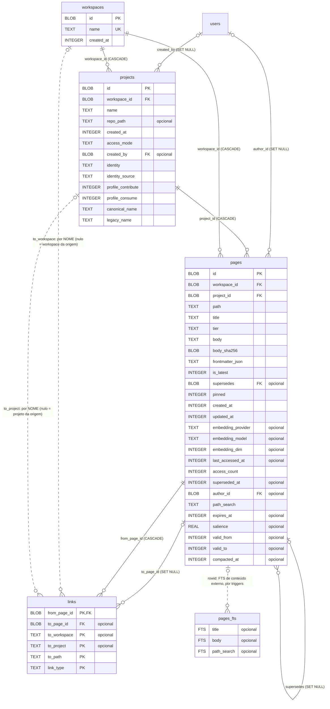
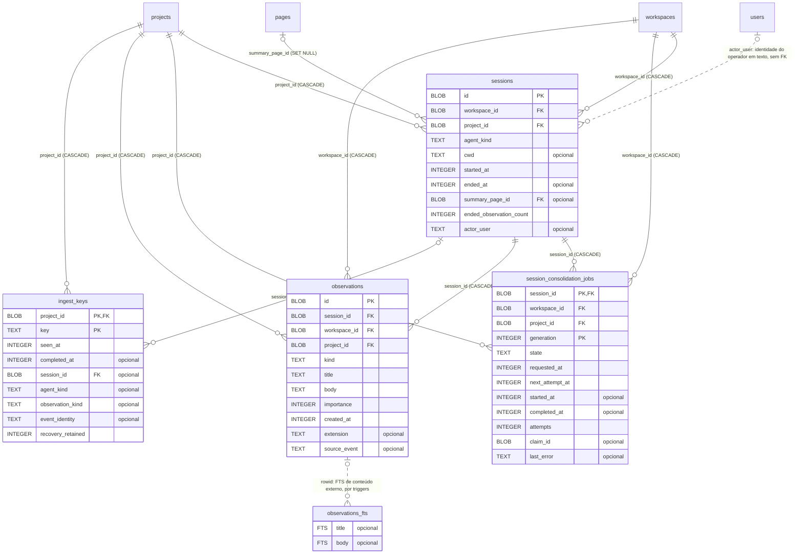
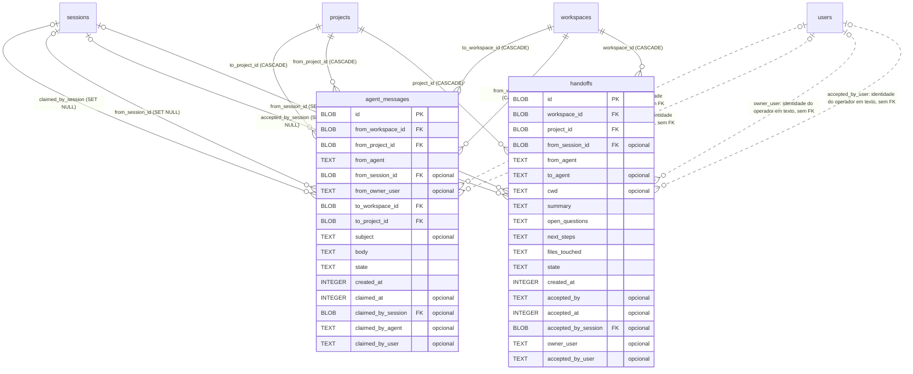
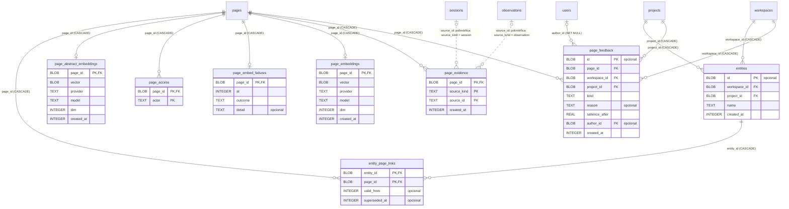
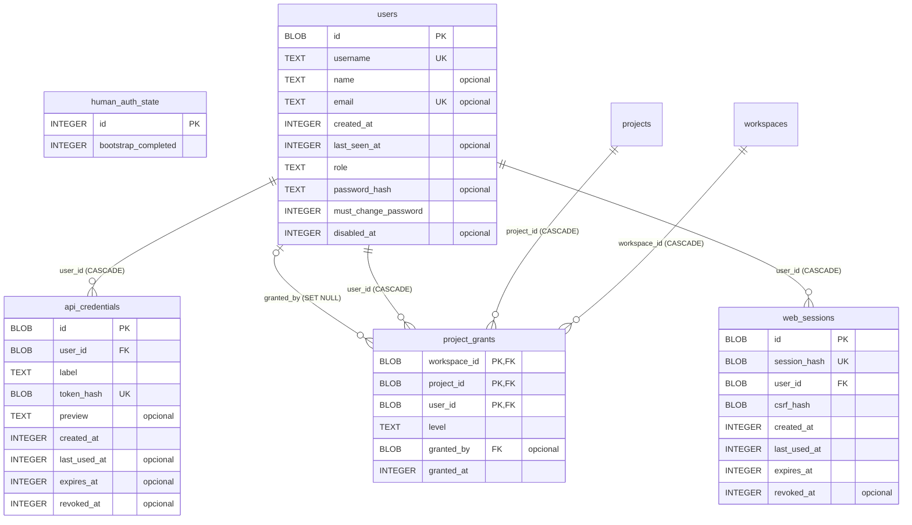
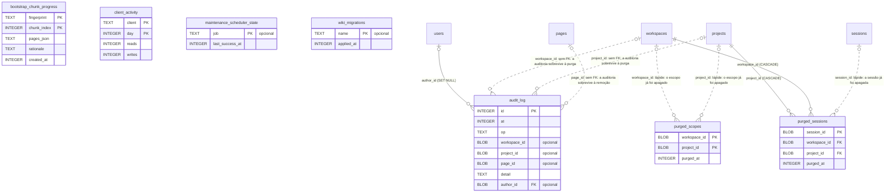
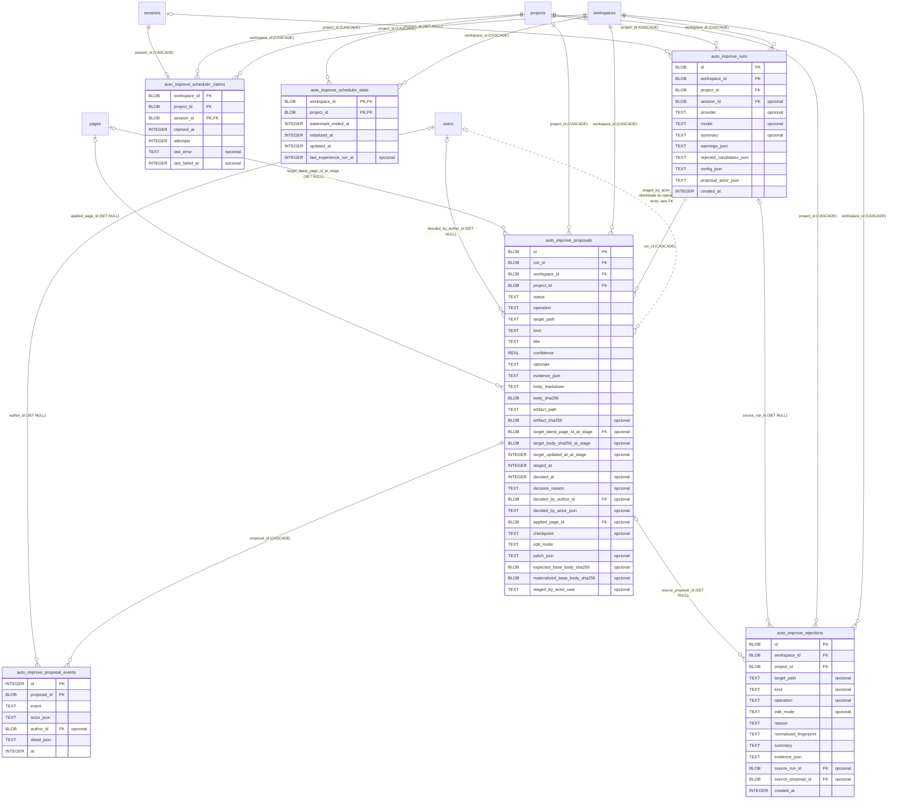
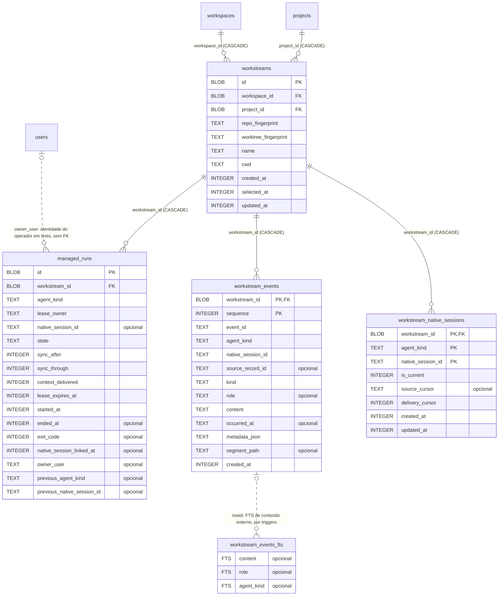
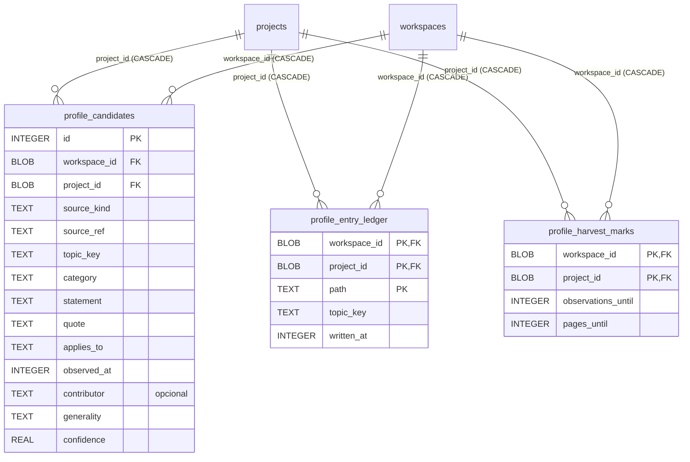

# Modelo de dados (diagramas)

> **Papel:** visão relacional do esquema de [database-schema.md](database-schema.md), no estilo de um
> modelo físico (tabelas, chaves, cardinalidade, regras de exclusão e dependências). Gerado do estado
> final das 83 migrações da versão 3.1.1 da referência. Onde este documento e o
> `database-schema.md` divergirem, vale o `database-schema.md`, que traz as restrições `CHECK`, os índices
> e os triggers. Os diagramas usam [Mermaid](https://mermaid.js.org/syntax/entityRelationshipDiagram.html).

## Como ler

| Notação | Significado |
|---|---|
| `PK`, `FK`, `UK` | chave primária, chave estrangeira, coluna única sozinha |
| `"opcional"` | a coluna aceita nulo |
| `\|\|--o{` | o filho aponta obrigatoriamente para **um** pai; o pai tem zero ou mais filhos |
| `\|o--o{` | a referência do filho é opcional (FK que aceita nulo) |
| `\|\|--o\|` | um para zero ou um (a FK do filho também é chave única) |
| linha tracejada (`..`) | ligação **lógica**, sem chave estrangeira no banco (o rótulo diz por quê) |
| `(CASCADE)`, `(SET NULL)` | o que acontece com o filho quando o pai é apagado |

Convenções do banco que os diagramas não mostram: identificadores são `BLOB` de 16 bytes (UUIDv7), instantes
são `INTEGER` em microssegundos UTC, booleanos são `INTEGER` 0/1 com `CHECK`, JSON é `TEXT`. Toda tabela com
`workspace_id` **e** `project_id` tem trigger que recusa um par que não combina (`database-schema.md` §0.1).
As chaves estrangeiras só valem com `foreign_keys = ON`, o modo de execução (as migrações rodam com OFF).

## 1. Mapa geral

Todas as 46 tabelas e as 82 chaves estrangeiras, sem colunas.
Ligações lógicas estão nos diagramas de domínio e na seção 3.

```mermaid
erDiagram
    sessions |o--o{ agent_messages : "claimed_by_session (SET NULL)"
    sessions |o--o{ agent_messages : "from_session_id (SET NULL)"
    projects ||--o{ agent_messages : "to_project_id (CASCADE)"
    workspaces ||--o{ agent_messages : "to_workspace_id (CASCADE)"
    projects ||--o{ agent_messages : "from_project_id (CASCADE)"
    workspaces ||--o{ agent_messages : "from_workspace_id (CASCADE)"
    users ||--o{ api_credentials : "user_id (CASCADE)"
    users |o--o{ audit_log : "author_id (SET NULL)"
    users |o--o{ auto_improve_proposal_events : "author_id (SET NULL)"
    auto_improve_proposals ||--o{ auto_improve_proposal_events : "proposal_id (CASCADE)"
    pages |o--o{ auto_improve_proposals : "applied_page_id (SET NULL)"
    users |o--o{ auto_improve_proposals : "decided_by_author_id (SET NULL)"
    pages |o--o{ auto_improve_proposals : "target_latest_page_id_at_stage (SET NULL)"
    projects ||--o{ auto_improve_proposals : "project_id (CASCADE)"
    workspaces ||--o{ auto_improve_proposals : "workspace_id (CASCADE)"
    auto_improve_runs ||--o{ auto_improve_proposals : "run_id (CASCADE)"
    auto_improve_proposals |o--o{ auto_improve_rejections : "source_proposal_id (SET NULL)"
    auto_improve_runs |o--o{ auto_improve_rejections : "source_run_id (SET NULL)"
    projects ||--o{ auto_improve_rejections : "project_id (CASCADE)"
    workspaces ||--o{ auto_improve_rejections : "workspace_id (CASCADE)"
    sessions |o--o{ auto_improve_runs : "session_id (SET NULL)"
    projects ||--o{ auto_improve_runs : "project_id (CASCADE)"
    workspaces ||--o{ auto_improve_runs : "workspace_id (CASCADE)"
    sessions ||--o| auto_improve_scheduler_claims : "session_id (CASCADE)"
    projects ||--o{ auto_improve_scheduler_claims : "project_id (CASCADE)"
    workspaces ||--o{ auto_improve_scheduler_claims : "workspace_id (CASCADE)"
    projects ||--o{ auto_improve_scheduler_state : "project_id (CASCADE)"
    workspaces ||--o{ auto_improve_scheduler_state : "workspace_id (CASCADE)"
    projects ||--o{ entities : "project_id (CASCADE)"
    workspaces ||--o{ entities : "workspace_id (CASCADE)"
    pages ||--o{ entity_page_links : "page_id (CASCADE)"
    entities ||--o{ entity_page_links : "entity_id (CASCADE)"
    sessions |o--o{ handoffs : "accepted_by_session (SET NULL)"
    sessions |o--o{ handoffs : "from_session_id (SET NULL)"
    projects ||--o{ handoffs : "project_id (CASCADE)"
    workspaces ||--o{ handoffs : "workspace_id (CASCADE)"
    sessions |o--o{ ingest_keys : "session_id (CASCADE)"
    projects ||--o{ ingest_keys : "project_id (CASCADE)"
    pages |o--o{ links : "to_page_id (SET NULL)"
    pages ||--o{ links : "from_page_id (CASCADE)"
    workstreams ||--o{ managed_runs : "workstream_id (CASCADE)"
    projects ||--o{ observations : "project_id (CASCADE)"
    workspaces ||--o{ observations : "workspace_id (CASCADE)"
    sessions ||--o{ observations : "session_id (CASCADE)"
    pages ||--o| page_abstract_embeddings : "page_id (CASCADE)"
    pages ||--o{ page_access : "page_id (CASCADE)"
    pages ||--o| page_embed_failures : "page_id (CASCADE)"
    pages ||--o| page_embeddings : "page_id (CASCADE)"
    pages ||--o{ page_evidence : "page_id (CASCADE)"
    users |o--o{ page_feedback : "author_id (SET NULL)"
    projects ||--o{ page_feedback : "project_id (CASCADE)"
    workspaces ||--o{ page_feedback : "workspace_id (CASCADE)"
    pages ||--o{ page_feedback : "page_id (CASCADE)"
    users |o--o{ pages : "author_id (SET NULL)"
    pages |o--o{ pages : "supersedes (SET NULL)"
    projects ||--o{ pages : "project_id (CASCADE)"
    workspaces ||--o{ pages : "workspace_id (CASCADE)"
    projects ||--o{ profile_candidates : "project_id (CASCADE)"
    workspaces ||--o{ profile_candidates : "workspace_id (CASCADE)"
    projects ||--o{ profile_entry_ledger : "project_id (CASCADE)"
    workspaces ||--o{ profile_entry_ledger : "workspace_id (CASCADE)"
    projects ||--o{ profile_harvest_marks : "project_id (CASCADE)"
    workspaces ||--o{ profile_harvest_marks : "workspace_id (CASCADE)"
    users |o--o{ project_grants : "granted_by (SET NULL)"
    users ||--o{ project_grants : "user_id (CASCADE)"
    projects ||--o{ project_grants : "project_id (CASCADE)"
    workspaces ||--o{ project_grants : "workspace_id (CASCADE)"
    users |o--o{ projects : "created_by (SET NULL)"
    workspaces ||--o{ projects : "workspace_id (CASCADE)"
    projects ||--o{ purged_sessions : "project_id (CASCADE)"
    workspaces ||--o{ purged_sessions : "workspace_id (CASCADE)"
    projects ||--o{ session_consolidation_jobs : "project_id (CASCADE)"
    workspaces ||--o{ session_consolidation_jobs : "workspace_id (CASCADE)"
    sessions ||--o{ session_consolidation_jobs : "session_id (CASCADE)"
    pages |o--o{ sessions : "summary_page_id (SET NULL)"
    projects ||--o{ sessions : "project_id (CASCADE)"
    workspaces ||--o{ sessions : "workspace_id (CASCADE)"
    users ||--o{ web_sessions : "user_id (CASCADE)"
    workstreams ||--o{ workstream_events : "workstream_id (CASCADE)"
    workstreams ||--o{ workstream_native_sessions : "workstream_id (CASCADE)"
    projects ||--o{ workstreams : "project_id (CASCADE)"
    workspaces ||--o{ workstreams : "workspace_id (CASCADE)"
    bootstrap_chunk_progress {
        TEXT fingerprint PK
    }
    client_activity {
        TEXT client PK
    }
    human_auth_state {
        INTEGER id PK
    }
    maintenance_scheduler_state {
        TEXT job PK "opcional"
    }
    observations_fts {
        FTS title "opcional"
    }
    pages_fts {
        FTS title "opcional"
    }
    purged_scopes {
        BLOB workspace_id PK
    }
    wiki_migrations {
        TEXT name PK "opcional"
    }
    workstream_events_fts {
        FTS content "opcional"
    }
```

Tabelas sem nenhuma chave estrangeira (de ou para): `bootstrap_chunk_progress`, `client_activity`, `human_auth_state`, `maintenance_scheduler_state`, `observations_fts`, `pages_fts`, `purged_scopes`, `wiki_migrations`, `workstream_events_fts`.

## 2. Diagramas por domínio

Cada diagrama mostra as colunas das tabelas do domínio. Tabelas de outros domínios aparecem só pelo nome,
quando são alvo de uma ligação.

### 2.1 Núcleo: escopo, páginas, links

### 2.2 Sessões e observações

### 2.3 Handoffs e mensagens entre projetos

### 2.4 Embeddings, feedback, entidades, evidência

### 2.5 Usuários, credenciais e sessões web

### 2.6 Auditoria, atividade e manutenção

### 2.7 Auto-melhoria

### 2.8 Workstreams gerenciados (continuidade entre harnesses)

### 2.9 Perfil entre projetos

## 3. Ligações lógicas (sem chave estrangeira)

O banco não garante estas ligações. A aplicação garante, ou elas existem de propósito sem garantia.

| Tabela.coluna | Aponta para | Por quê |
|---|---|---|
| `audit_log.workspace_id` | `workspaces` | sem FK: a auditoria sobrevive à purga |
| `audit_log.project_id` | `projects` | sem FK: a auditoria sobrevive à purga |
| `audit_log.page_id` | `pages` | sem FK: a auditoria sobrevive à remoção |
| `purged_scopes.workspace_id` | `workspaces` | lápide: o escopo já foi apagado |
| `purged_scopes.project_id` | `projects` | lápide: o escopo já foi apagado |
| `purged_sessions.session_id` | `sessions` | lápide: a sessão já foi apagada |
| `links.to_workspace` | `workspaces` | por NOME (nulo = workspace da origem) |
| `links.to_project` | `projects` | por NOME (nulo = projeto da origem) |
| `page_evidence.source_id` | `sessions` | polimórfica: source_kind = session |
| `page_evidence.source_id` | `observations` | polimórfica: source_kind = observation |
| `pages_fts.rowid` | `pages` | FTS de conteúdo externo, por triggers |
| `observations_fts.rowid` | `observations` | FTS de conteúdo externo, por triggers |
| `workstream_events_fts.rowid` | `workstream_events` | FTS de conteúdo externo, por triggers |
| `agent_messages.from_owner_user` | identidade do operador | chave de armazenamento da identidade (texto); **não** é FK para `users`, e continua válida para operadores sem linha em `users` |
| `agent_messages.claimed_by_user` | identidade do operador | chave de armazenamento da identidade (texto); **não** é FK para `users`, e continua válida para operadores sem linha em `users` |
| `auto_improve_proposals.staged_by_actor_user` | identidade do operador | chave de armazenamento da identidade (texto); **não** é FK para `users`, e continua válida para operadores sem linha em `users` |
| `handoffs.owner_user` | identidade do operador | chave de armazenamento da identidade (texto); **não** é FK para `users`, e continua válida para operadores sem linha em `users` |
| `handoffs.accepted_by_user` | identidade do operador | chave de armazenamento da identidade (texto); **não** é FK para `users`, e continua válida para operadores sem linha em `users` |
| `managed_runs.owner_user` | identidade do operador | chave de armazenamento da identidade (texto); **não** é FK para `users`, e continua válida para operadores sem linha em `users` |
| `sessions.actor_user` | identidade do operador | chave de armazenamento da identidade (texto); **não** é FK para `users`, e continua válida para operadores sem linha em `users` |

Outras colunas de identificador sem FK, que guardam ids **externos** (do agente ou do harness), não ids deste banco:
`managed_runs.native_session_id`, `managed_runs.previous_native_session_id`, `workstream_events.native_session_id`,
`workstream_events.event_id`, `workstream_events.source_record_id`, `workstream_native_sessions.native_session_id`
e `session_consolidation_jobs.claim_id` (token de reivindicação do job). `web_sessions.session_hash` é o hash do
segredo da sessão web, não uma referência.

A tabela de controle de migrações (`refinery_schema_history`: `version`, `name`, `applied_on`, `checksum`) não
aparece nos diagramas porque é criada pela ferramenta de migração, não pelas migrações. `wiki_migrations` guarda
as migrações de estrutura da wiki ([wiki-files-layer.md](wiki-files-layer.md) §10).

## 4. Efeito de apagar uma linha (regras `ON DELETE`)

Para cada tabela que é alvo de chave estrangeira: o que acontece nas filhas quando uma linha dela é apagada.
`CASCADE` apaga a filha; `SET NULL` só limpa a referência. A cascata continua nas filhas das filhas.

| Ao apagar em | Apaga em cascata | Só limpa a referência (`SET NULL`) |
|---|---|---|
| `auto_improve_proposals` | `auto_improve_proposal_events.proposal_id` | `auto_improve_rejections.source_proposal_id` |
| `auto_improve_runs` | `auto_improve_proposals.run_id` | `auto_improve_rejections.source_run_id` |
| `entities` | `entity_page_links.entity_id` | — |
| `pages` | `entity_page_links.page_id`, `links.from_page_id`, `page_abstract_embeddings.page_id`, `page_access.page_id`, `page_embed_failures.page_id`, `page_embeddings.page_id`, `page_evidence.page_id`, `page_feedback.page_id` | `auto_improve_proposals.applied_page_id`, `auto_improve_proposals.target_latest_page_id_at_stage`, `links.to_page_id`, `pages.supersedes`, `sessions.summary_page_id` |
| `projects` | `agent_messages.from_project_id`, `agent_messages.to_project_id`, `auto_improve_proposals.project_id`, `auto_improve_rejections.project_id`, `auto_improve_runs.project_id`, `auto_improve_scheduler_claims.project_id`, `auto_improve_scheduler_state.project_id`, `entities.project_id`, `handoffs.project_id`, `ingest_keys.project_id`, `observations.project_id`, `page_feedback.project_id`, `pages.project_id`, `profile_candidates.project_id`, `profile_entry_ledger.project_id`, `profile_harvest_marks.project_id`, `project_grants.project_id`, `purged_sessions.project_id`, `session_consolidation_jobs.project_id`, `sessions.project_id`, `workstreams.project_id` | — |
| `sessions` | `auto_improve_scheduler_claims.session_id`, `ingest_keys.session_id`, `observations.session_id`, `session_consolidation_jobs.session_id` | `agent_messages.claimed_by_session`, `agent_messages.from_session_id`, `auto_improve_runs.session_id`, `handoffs.accepted_by_session`, `handoffs.from_session_id` |
| `users` | `api_credentials.user_id`, `project_grants.user_id`, `web_sessions.user_id` | `audit_log.author_id`, `auto_improve_proposal_events.author_id`, `auto_improve_proposals.decided_by_author_id`, `page_feedback.author_id`, `pages.author_id`, `project_grants.granted_by`, `projects.created_by` |
| `workspaces` | `agent_messages.from_workspace_id`, `agent_messages.to_workspace_id`, `auto_improve_proposals.workspace_id`, `auto_improve_rejections.workspace_id`, `auto_improve_runs.workspace_id`, `auto_improve_scheduler_claims.workspace_id`, `auto_improve_scheduler_state.workspace_id`, `entities.workspace_id`, `handoffs.workspace_id`, `observations.workspace_id`, `page_feedback.workspace_id`, `pages.workspace_id`, `profile_candidates.workspace_id`, `profile_entry_ledger.workspace_id`, `profile_harvest_marks.workspace_id`, `project_grants.workspace_id`, `projects.workspace_id`, `purged_sessions.workspace_id`, `session_consolidation_jobs.workspace_id`, `sessions.workspace_id`, `workstreams.workspace_id` | — |
| `workstreams` | `managed_runs.workstream_id`, `workstream_events.workstream_id`, `workstream_native_sessions.workstream_id` | — |

- Apagar uma linha de `workspaces` remove, em cascata, linhas de: `agent_messages`, `auto_improve_proposal_events`, `auto_improve_proposals`, `auto_improve_rejections`, `auto_improve_runs`, `auto_improve_scheduler_claims`, `auto_improve_scheduler_state`, `entities`, `entity_page_links`, `handoffs`, `ingest_keys`, `links`, `managed_runs`, `observations`, `page_abstract_embeddings`, `page_access`, `page_embed_failures`, `page_embeddings`, `page_evidence`, `page_feedback`, `pages`, `profile_candidates`, `profile_entry_ledger`, `profile_harvest_marks`, `project_grants`, `projects`, `purged_sessions`, `session_consolidation_jobs`, `sessions`, `workstream_events`, `workstream_native_sessions`, `workstreams`.
- Apagar uma linha de `projects` remove, em cascata, linhas de: `agent_messages`, `auto_improve_proposal_events`, `auto_improve_proposals`, `auto_improve_rejections`, `auto_improve_runs`, `auto_improve_scheduler_claims`, `auto_improve_scheduler_state`, `entities`, `entity_page_links`, `handoffs`, `ingest_keys`, `links`, `managed_runs`, `observations`, `page_abstract_embeddings`, `page_access`, `page_embed_failures`, `page_embeddings`, `page_evidence`, `page_feedback`, `pages`, `profile_candidates`, `profile_entry_ledger`, `profile_harvest_marks`, `project_grants`, `purged_sessions`, `session_consolidation_jobs`, `sessions`, `workstream_events`, `workstream_native_sessions`, `workstreams`.
- Apagar uma linha de `pages` remove, em cascata, linhas de: `entity_page_links`, `links`, `page_abstract_embeddings`, `page_access`, `page_embed_failures`, `page_embeddings`, `page_evidence`, `page_feedback`.
- Apagar uma linha de `sessions` remove, em cascata, linhas de: `auto_improve_scheduler_claims`, `ingest_keys`, `observations`, `session_consolidation_jobs`.
- Apagar uma linha de `users` remove, em cascata, linhas de: `api_credentials`, `project_grants`, `web_sessions`.

Isso não substitui a purga: a purga grava a lápide (`purged_scopes`, `purged_sessions`) na mesma transação,
para que um evento atrasado não recrie o que foi apagado ([database-schema.md](database-schema.md) §11).
`audit_log` não tem chave estrangeira para escopo nem página, então sobrevive a qualquer exclusão.

## 5. Ordem de inserção (dependências)

Uma tabela só pode receber linhas depois das tabelas para as quais ela tem FK **obrigatória** (`NOT NULL`).
Níveis calculados por ordenação topológica; tabelas do mesmo nível não dependem umas das outras.
Autorreferências (`pages.supersedes`) e FKs opcionais não contam.

| Nível | Tabelas |
|---|---|
| 0 | `audit_log`, `bootstrap_chunk_progress`, `client_activity`, `human_auth_state`, `maintenance_scheduler_state`, `observations_fts`, `pages_fts`, `purged_scopes`, `users`, `wiki_migrations`, `workspaces`, `workstream_events_fts` |
| 1 | `api_credentials`, `projects`, `web_sessions` |
| 2 | `agent_messages`, `auto_improve_rejections`, `auto_improve_runs`, `auto_improve_scheduler_state`, `entities`, `handoffs`, `ingest_keys`, `pages`, `profile_candidates`, `profile_entry_ledger`, `profile_harvest_marks`, `project_grants`, `purged_sessions`, `sessions`, `workstreams` |
| 3 | `auto_improve_proposals`, `auto_improve_scheduler_claims`, `entity_page_links`, `links`, `managed_runs`, `observations`, `page_abstract_embeddings`, `page_access`, `page_embed_failures`, `page_embeddings`, `page_evidence`, `page_feedback`, `session_consolidation_jobs`, `workstream_events`, `workstream_native_sessions` |
| 4 | `auto_improve_proposal_events` |

## 6. O que é derivado da wiki e o que só existe no banco

A reindexação a partir do markdown ([wiki-files-layer.md](wiki-files-layer.md) §5.4) reconstrói **só**:
`workspaces`, `projects`, `pages` (versões correntes), `links`, `entities`, `entity_page_links` e `pages_fts`.
Todo o resto é estado só do banco (sessões, observações, handoffs, mensagens, usuários e credenciais,
auditoria, embeddings, feedback, acesso, evidências, auto-melhoria, workstreams, perfil, lápides e
agendadores) e precisa de backup do arquivo do banco. Versões antigas de página (`is_latest = 0`) também não
voltam numa reindexação: o histórico delas fica só no banco e no Git.
